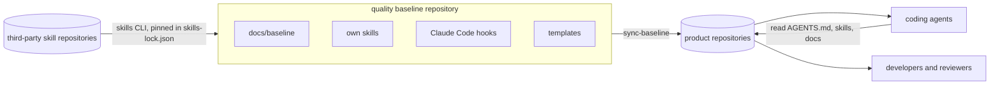

# 3. Context and Scope

The baseline's own context: who and what it interacts with. A product's chapter 3 describes the product's users and neighbouring systems instead.

| Neighbour | Interaction |
|---|---|
| Product repositories | Receive the baseline docs and the skills and hooks of their declared stacks, and once the project templates, through `scripts/sync-baseline`; the full list is in [agent-skills.md](../08-crosscutting-concepts/development/agent-skills.md#distribution-to-consuming-projects) |
| Third-party skill repositories | Source of framework know-how skills, installed with the pinned `skills` CLI and reviewed (TOOL-SKL-02/03) |
| Coding agents | Read `AGENTS.md`, load skills, follow the docs; the hooks of the declared stacks remind them of the stack's entry skill |
| Developers, reviewers, architects | Use the docs and rule IDs; decide on deviations via ADRs |

## Scope

In scope: architecture, code organisation, testing, API contracts, accessibility, security, persistence, logging, tooling, repository layout and agent setup for our Java/Spring and Node/NestJS backends and TypeScript frontends (Angular, React SPA, Next.js).

Also in scope: **application-side operability**, meaning what the application itself must provide so it can be run: health and readiness endpoints, metrics, externalised and validated configuration, graceful shutdown, database migrations at deploy time, resilience towards the systems it calls, and retention and deletion of the data it stores. The rules are in [configuration](../08-crosscutting-concepts/configuration/configuration.md), [observability](../08-crosscutting-concepts/observability/observability.md), [resilience](../08-crosscutting-concepts/resilience/resilience.md), [delivery and release](../07-deployment-view/delivery-and-release.md) and [data protection](../08-crosscutting-concepts/data-protection/data-protection.md).

Out of scope: product-specific requirements and the **infrastructure** the application runs on (clusters, networks, hosting, CI system, registry, secret store, backups, monitoring stacks, on-call). These are usually the customer's. The baseline states what it needs from them as capabilities and names reference tools that can be replaced; each product records the concrete platform in its chapter 7 (delivery platform mapping, REL-CD-06) and its targets in chapter 10.
