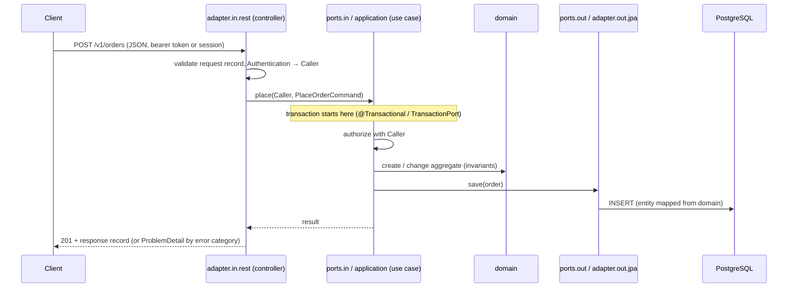
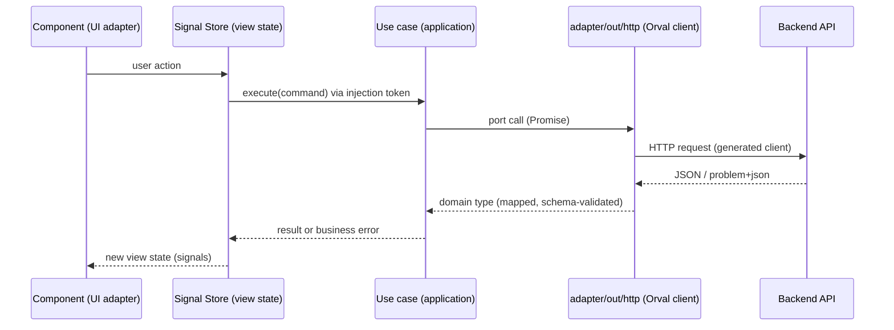

# 6. Runtime View

How the building blocks of chapter 5 work together at runtime, for the scenarios every product has. The rules are in the linked chapters; this chapter only shows the flow. A product's chapter 6 adds its important business scenarios.

## State-changing request (backend)

Rules: SPRING-REST-01/07, SPRING-SEC-01/02, SPRING-ARCH-07/09/18, ARCH-UC-11/13/15, ARCH-MAP-01/02, ARCH-ADP. NestJS: NEST-REST-01/14, NEST-SEC-01/02, NEST-ARCH-08/12, NEST-DB-06.

## Query with related data (backend)

The query port loads everything the screen needs in a bounded number of statements (SPRING-TEST-06, NEST-DB-12, API-N1-05); the controller maps the result to one response, paged (SPRING-REST-11, NEST-REST-17).

## Frontend interaction

Rules: NG-STATE-02, NG-ARCH-13, TS-ARCH-04, TS-API. React: a Redux Toolkit slice holds view state that several components share, and commands are TanStack mutations that call the use case (REACT-STATE-03), server data is loaded by TanStack Query whose `queryFn` calls the use case (REACT-ARCH-13); Next.js server components and server actions call use cases from the request-scoped server composition (NEXT-ARCH-02..04).

## Message from Kafka

The listener in `adapter.in.kafka` deserializes, maps to a command with a system `Caller`, and calls the same incoming port as the REST adapter (SPRING-ARCH-12, SPRING-SEC-02). Retries and dead-letter handling stay in the adapter and follow the error categories ([ARCH-UC-13](../05-building-block-view/use-cases.md)): validation and business-rule failures go to the consumer's dead-letter topic at once, transient failures are retried with backoff first ([MSG-ERR-01](../08-crosscutting-concepts/messaging/messaging.md), [SPRING-MSG-05](../08-crosscutting-concepts/messaging/spring.md)). The consumer is idempotent, because delivery is at least once (MSG-IDM-01/02). Events that must be consistent with a database write go through an outbox (SPRING-ARCH-13, SPRING-MSG-07). NestJS: NEST-SEC-02, [messaging/nestjs.md](../08-crosscutting-concepts/messaging/nestjs.md).

## Browser login (BFF)

The browser authenticates against the backend-for-frontend with OIDC; the BFF keeps the tokens and gives the browser a session cookie; API calls go through the BFF, which relays the access token to the resource server (SPRING-SEC-03/08/09, NEST-SEC-03/12/13; Node BFFs including Next.js: NODE-BFF-01..09). Starting a login never ends a live session: the pre-login state (PKCE verifier, state, nonce, return target) lives server-side until the callback, which issues a new session id (NODE-BFF-02/07).
