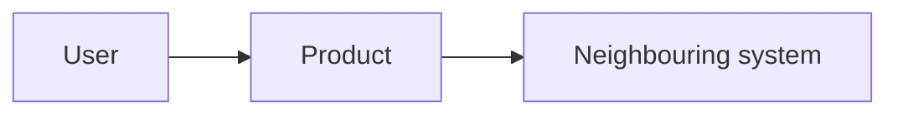

# 3. Context and Scope

<!-- Who uses the product and which systems it talks to. C4 level 1 (system context) as Mermaid (DOC-ARC-05). -->

## 3.1 Business context

| Partner | Input | Output |
|---|---|---|
| | | |

## 3.2 Technical context

<!-- Channels and protocols per partner (REST + OpenAPI spec, Kafka topics, OIDC provider, …). -->

| Partner | Channel / protocol | Contract |
|---|---|---|
| | | |
