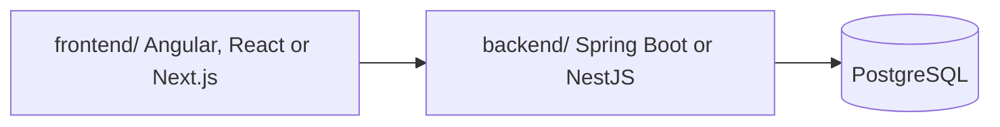

# 5. Building Block View

The structure inside each component follows the baseline: [../baseline/05-building-block-view](../baseline/05-building-block-view/README.md).

## 5.1 Level 1: components

<!-- C4 level 2 (containers = component folders) as Mermaid. -->

| Component | Responsibility | Folder |
|---|---|---|
| | | |

## 5.2 Level 2: inside the components

<!-- Per component: bounded contexts or features, their incoming and outgoing adapters and ports. -->
