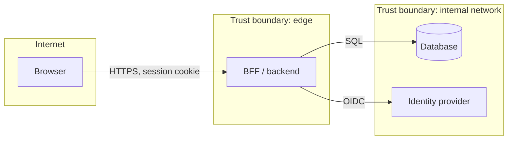

# Threat Model

<!-- SEC-TM-01: system-level threat model. Reviewed at least yearly and on every architecture change (DOC-ARC-06).
     Feature-level threat models go into the pull request (SEC-TM-02).
     Baseline rules: ../baseline/08-crosscutting-concepts/security/security-requirements.md -->

- **Last review:** <YYYY-MM-DD>, <who>
- **Next review due:** <YYYY-MM-DD> <!-- checked by the security date check (SEC-CI-08); keep the format -->

## 1. What are we working on?

<!-- Data-flow diagram with trust boundaries. Use the containers of docs/architecture/05-building-block-view.md. -->

| Trust boundary | Crossed by | Authentication | Data classes (see requirements.md) |
|---|---|---|---|
| <Internet → edge> | <HTTPS> | <OIDC session> | <personal, confidential> |

## 2. What can go wrong?

<!-- One row per threat. STRIDE or the Top 10:2025 categories help to find them. -->

| # | Threat | Element / boundary | Top 10:2025 | Likelihood | Impact |
|---|---|---|---|---|---|
| T1 | <A user reads another user's orders by changing the id> | <REST API> | A01 | <low/med/high> | <low/med/high> |

## 3. What will we do about it?

| Threat | Mitigation | Rule IDs / ASVS | Test (SEC-TM-03) | Status |
|---|---|---|---|---|
| T1 | <Owner check on the `Caller` in the use case> | <SPRING-SEC-16, ASVS V8> | <cross-user test in …> | <done / issue #> |

Accepted risks go to [exceptions.md](exceptions.md) (SEC-VUL-03).

## 4. Did we do a good job?

<!-- What the last review found, what changed since, open questions. -->
